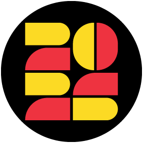
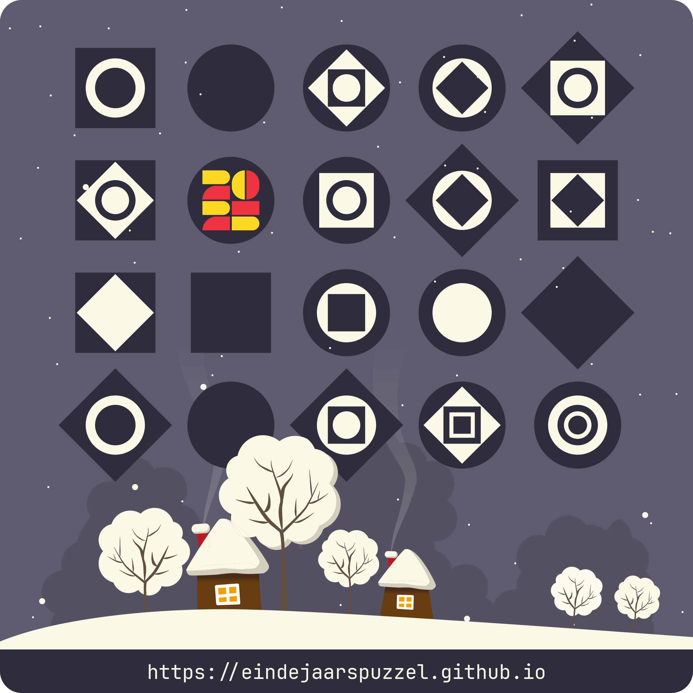

<link rel="stylesheet" href="https://cdnjs.cloudflare.com/ajax/libs/font-awesome/4.7.0/css/font-awesome.min.css">
<link rel="stylesheet" href="localstyle.css">

  

# Eindejaarspuzzel 2026

## Over de puzzel

Na het officiële stopzetten van de ADIV-eindejaarspuzzel in 2025 hebben wij, een team van zowel nieuwe puzzelmakers als makers van de vorige editie, de uitdaging aangenomen om een gloednieuwe moeilijkste puzzel van België te creëren.

In 2026 brengen we onze tweede eindejaarspuzzel uit. Deze nieuwe puzzel zit opnieuw boordevol encryptiemethodes, verwijzingen naar het afgelopen jaar en wetenschappelijke links.

## Opgaven

De opgaven van 2026 zijn nog niet beschikbaar. Wil je op de hoogte blijven, dan kun je alvast een berichtje sturen naar <a href="mailto:eindejaarspuzzel@gmail.com">eindejaarspuzzel@gmail.com</a> of het onderstaande formuliertje invullen.

<!-- 

<a href="mailto:eindejaarspuzzel@gmail.com">
Hou mij op de hoogte! <i class="fa fa-paper-plane"></i>
</a>

 -->

<form id="signup">
  <label for="email">E-mailadres</label>
  <input type="email" id="email" name="email" required maxlength="64" autocomplete="email">
  <input type="text" name="_honey" style="display:none" tabindex="-1" autocomplete="off">
  <input type="hidden" name="_subject" value="New signup">
  <input type="hidden" name="_captcha" value="false">
  
<button type="submit">Hou mij op de hoogte! <i class="fa fa-paper-plane"></i></button>

</form>

  
<h2>Resultaten 2025</h2>

  
  
We ontvingen voor de editie 2025 antwoorden van 35 teams. Hartelijk bedankt voor jullie deelname!

  
Het was enorm spannend aan de absolute top van het klassement: twee teams bleven nek aan nek en het verschil werd uiteindelijk gemaakt met slechts een half punt! Het waren <b>Wessel, Barry, Ruben en Thomas</b> die de topscore van 160,5 punten behaalden. Omdat het zo close was, willen we ook een eervolle vermelding geven aan <b>de Pseudoku’s</b> met 160 punten. Proficiat aan beide teams, maar evenzeer proficiat én bedankt aan alle andere deelnemende ploegen.

<!--
## Contacteer ons

Voor vragen/opmerkingen naar volgend jaar toe zijn we nog steeds bereikbaar via <a href="mailto:eindejaarspuzzel@gmail.com">eindejaarspuzzel@gmail.com</a>. Houd er wel rekening mee dat die mailbox in het tussenseizoen slechts sporadisch gemonitord wordt.
-->

<!--
## Regels

Deelnemen kan alleen of in groep en je kan gebruikmaken van alle bronnen die je ter beschikking hebt. Wel vragen we jullie om geen antwoorden of hints te delen tussen teams vóór de deadline op **30 januari 2026**. Meer informatie vind je in het voorwoord van de puzzel.

## Vragen

Als je denkt een fout te hebben gevonden in een van de opgaves, dan kan je die melden door te mailen naar <a href="mailto:eindejaarspuzzel@gmail.com">eindejaarspuzzel@gmail.com</a>. Wij beantwoorden geen inhoudelijke vragen over de puzzel.
-->

## Vorige edities

Weet je niet waar je moet beginnen? Bekijk dan de opgaves en oplossingen van de voorgaande eindejaarspuzzel. Dit geeft je een idee van de te volgen richting.

| Opgave                              | Oplossingen                              | Hints |
|-------------------------------------|------------------------------------------|-------|
| <a href="2025/2025_opgave.pdf"> opgave 2025 <i class="fa fa-download"></i></a> | <a href="2025/2025_oplossingen.pdf"> oplossingen 2025 <i class="fa fa-download"></i></a> | <a href="2025/2025_hints.pdf"> hints 2025 <i class="fa fa-download"></i></a> |

Voor de volledigheid kun je hier ook de originele reeks eindejaarspuzzels van de Belgische defensie terugvinden.

| Opgave                              | Oplossingen                              |
|----------------------------------------|----------------------------------------|
| <a href="vorige_edities/2024_opgave_nl.pdf"> opgave 2024 <i class="fa fa-download"></i></a> | <a href="vorige_edities/2024_oplossingen_NL.pdf"> oplossingen 2024 <i class="fa fa-download"></i></a> |
| <a href="vorige_edities/2023_opgave_nl.pdf"> opgave 2023 <i class="fa fa-download"></i></a> | <a href="vorige_edities/2023_oplossingen_NL.pdf"> oplossingen 2023 <i class="fa fa-download"></i></a> |
| <a href="vorige_edities/2022_opgave_nl_erratum.pdf"> opgave 2022 <i class="fa fa-download"></i></a> | <a href="vorige_edities/2022_oplossingen_NL.pdf"> oplossingen 2022 <i class="fa fa-download"></i></a> |
| <a href="vorige_edities/2021_opgave_NL.pdf"> opgave 2021 <i class="fa fa-download"></i></a> | <a href="vorige_edities/2021_oplossingen_nl.pdf"> oplossingen 2021 <i class="fa fa-download"></i></a> |
| <a href="vorige_edities/2020_opgave_NL.pdf"> opgave 2020 <i class="fa fa-download"></i></a> | <a href="vorige_edities/2020_oplossingen_NL.pdf"> oplossingen 2020 <i class="fa fa-download"></i></a> |
| <a href="vorige_edities/2019_opgave_NL.pdf"> opgave 2019 <i class="fa fa-download"></i></a> | <a href="vorige_edities/2019_oplossingen_NL.pdf"> oplossingen 2019 <i class="fa fa-download"></i></a> |
| <a href="vorige_edities/2018_opgave_NL.pdf"> opgave 2018 <i class="fa fa-download"></i></a> | <a href="vorige_edities/2018_oplossingen_NL.pdf"> oplossingen 2018 <i class="fa fa-download"></i></a> |

<!-- ## Teaser
Met deze teaser kondigden we eerder de startdatum van de puzzel aan:

  

 -->
